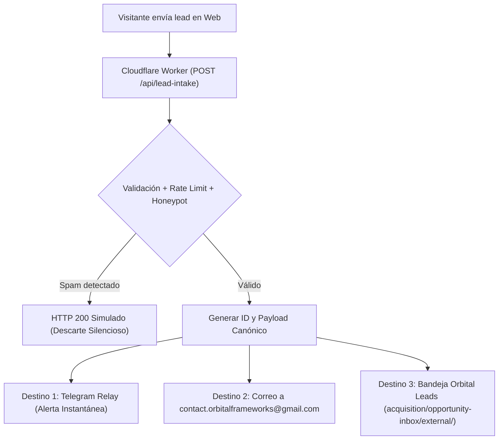

# Blindaje Edge de Cloudflare, Observabilidad en 2 Capas y Pipeline de Captura Triple

**Fecha:** 8 de noviembre de 2026 (Lima)
**Zona de despliegue:** `orbitalframeworks.qzz.io` (Cloudflare DNS Proxy / Worker)
**Autoridad:** `canonical-edge-observability-lead-intake`
**Clasificación:** COMPANY_ASSET / PRIVADO
**Estado:** IMPLEMENTADO / LISTO PARA STAGING Y QA

---

## 1. Resumen Ejecutivo y Diagnóstico de Infraestructura

El análisis forense consolidado del 8 de noviembre de 2026 demostró que:
1. **Tráfico de infraestructura vs comercial:** El **61,7 %** de las 63.061 solicitudes registradas en Cloudflare (del 09/10 al 07/11) correspondió a rutas operativas internas de túneles MCP y DevSpace (`/mcp`: ~18.500, `/healthz`: ~11.370, `/.well-known/oauth-authorization-server`: ~9.070). Además, el pico de ancho de banda de 149,8 MB del 6 de noviembre correspondió al rastreo automatizado de la Auditoría Web V2. El tráfico humano comercial real estimado en Perú se ubica en 10–25 personas/mes con 3 impresiones en Google Search Console y 4 sesiones consentidas en GA4.
2. **Ceguera analítica por consentimiento:** GA4 opera estrictamente bajo consentimiento del usuario (`grantAnalyticsConsent()`). Al no existir consentimiento en la gran mayoría de visitas de paso, el embudo carecía de métricas sobre tiempo de atención por sección, profundidad de scroll y fricción en la selección de carriles.
3. **Fricción en conversión:** Las páginas de servicios, casos y artículos dependían exclusivamente de enlaces a Gmail Web Compose (que falla o exige login web en navegadores móviles) sin permitir captura voluntaria de baja fricción (correo o WhatsApp/teléfono).
4. **Respuesta arquitectónica:** Implementar una solución en 2 niveles de observabilidad (Mapa de Atención First-Party sin cookies + Clarity/GA4 consent-aware), blindaje perimetral WAF con filtrado analítico de túneles y un pipeline de captura con triple destino (Telegram Relay, copia por correo e ingesta estructurada en Orbital Leads).

---

## 2. Reglas Canónicas de WAF Anti-Scraping en Cloudflare

Para proteger el sitio contra scrapers agresivos, herramientas headless y escáneres masivos que inflan métricas y consumen cuota de Edge/Amplify, se configuran las siguientes reglas WAF (Cloudflare Web Application Firewall Expressions).

### 2.1 Regla WAF: Anti-Scraping y Protección de Botnets no Verificadas

* **Nombre de regla:** `Orbital-Edge-AntiScraping-Protection`
* **Expresión Cloudflare:**
```text
(
  (cf.threat_score gt 25 or cf.client.bot)
  and not (
    cf.verified_bot_category in {"Search Engine Crawler", "Social Media Crawler"}
    or http.user_agent contains "Googlebot"
    or http.user_agent contains "LinkedInBot"
    or http.user_agent contains "bingbot"
    or http.user_agent contains "Twitterbot"
    or http.user_agent contains "facebookexternalhit"
  )
)
```
* **Acción recomendada:** `Managed Challenge` (Interactive Challenge si el threat score supera 50).
* **Justificación técnica:** Permite indexación completa y generación de previews a Googlebot, LinkedInBot y Bingbot, mientras exige verificación interactiva a scrapers automatizados sin reputación verificada.

---

## 3. Reglas de Hotlink Protection (Protección de Recursos Estáticos)

Protege los activos estáticos pesados (`/assets/*`, `/portfolio/*`, `/fonts/*`, `/favicon*`) contra incrustación no autorizada desde sitios de terceros, ahorrando egress y evitando leeching de marca, sin perjudicar la visualización de enlaces en redes sociales ni rastreadores.

### 3.1 Regla WAF: Hotlink Protection para Assets y Fuentes

* **Nombre de regla:** `Orbital-Edge-Hotlink-Protection`
* **Expresión Cloudflare:**
```text
(
  http.request.uri.path matches "^/(assets|portfolio|fonts)/.*"
  and not (
    http.referer eq ""
    or http.referer contains "orbitalframeworks.qzz.io"
    or http.referer contains "wasy.store"
    or http.referer contains "linkedin.com"
    or http.referer contains "t.co"
    or cf.verified_bot_category in {"Search Engine Crawler", "Social Media Crawler"}
    or http.user_agent contains "Googlebot"
    or http.user_agent contains "LinkedInBot"
    or http.user_agent contains "bingbot"
  )
)
```
* **Acción recomendada:** `Block` con código de estado HTTP 403 Forbidden.
* **Justificación técnica:** Las peticiones directas de usuarios (que a menudo llevan `Referer` vacío por políticas de privacidad del navegador) son aceptadas. Las peticiones con `Referer` proveniente del dominio propio o de socios de ecosistema (como `wasy.store`) son aceptadas. Se bloquean peticiones donde el `Referer` sea un dominio externo no autorizado incrustando imágenes o fuentes corporativas.

---

## 4. Filtro Analítico de Subdominios y Rutas de Túneles MCP / DevSpace

### 4.1 Problema Identificado
Las rutas de túneles operativos MCP y comprobación de salud representaron el 61,7% de todas las solicitudes HTTP registradas en Cloudflare:
* `/mcp` y `/mcp/*`: túnel de ejecución y herramientas remotas.
* `/healthz` y `/healthz/*`: verificaciones periódicas de estado y liveness de contenedores.
* `/.well-known/*` (incluyendo `/.well-known/oauth-authorization-server`): descubrimiento de metadatos OAuth.

### 4.2 Aislamiento en el Cloudflare Worker (`cloudflare-worker-content-negotiation.js`)
Para evitar la distorsión de las métricas comerciales y proteger el ancho de banda del Worker:
1. **Exclusión estricta de telemetría:** El endpoint `/api/telemetry` analiza la ruta de origen reportada (`payload.path`). Si la ruta coincide con `/mcp`, `/healthz` o `/.well-known/*`, la solicitud se descarta inmediatamente (`{ ignored: true, reason: 'tunnel_or_infra_path' }`) sin incrementar contadores ni registrar eventos de dwell time o scroll depth.
2. **Filtrado en capa de aplicación:** La función `isTunnelOrInfraPath(pathname)` evalúa de forma determinista cualquier prefijo sensible.
3. **Métricas limpias para el Sponsor:** Los reportes de conversión e inteligencia de negocio separan el tráfico técnico del tráfico de páginas públicas (`/`, `/servicios/*`, `/casos/*`, `/blog/*`, `/sobre-orbital-frameworks`).

---

## 5. Capa 1 de Observabilidad: Mapa de Atención First-Party sin Cookies ni PII

Implementado en `src/analytics.ts` y respaldado por el Worker en `POST /api/telemetry`.

### 5.1 Principios de Privacidad y Cumplimiento
* **Cero Cookies:** No escribe ni lee cookies (`document.cookie` no es utilizado).
* **Cero LocalStorage invasivo:** Solo `localStorage.getItem('orbital-analytics-consent')` se consulta para GA4/Clarity; el mapa de atención first-party opera en memoria por sesión.
* **Cero PII (Personally Identifiable Information):** Las URLs reportadas son sanitizadas automáticamente (`sanitizeUrl`), eliminando parámetros como `email`, `phone`, `token`, `auth`, `user`, etc. No se persisten IPs ni identificadores de dispositivos.
* **100% de Cobertura:** Se ejecuta desde la carga inicial de la página sin depender de que el usuario pulse "Aceptar" en el banner de cookies, ya que constituye analítica técnica y operativa agregada de rendimiento y atención de contenido.

### 5.2 Métricas Capturadas
1. **Tiempo de permanencia por sección (`section_dwell_ms`):**
   * Emplea `IntersectionObserver` con umbrales `[0, 0.25, 0.5, 0.75, 1.0]` para medir el tiempo real que un usuario mantiene una sección dentro de su viewport visible (≥25% de visibilidad).
   * Secciones monitorizadas: `<section>`, `[data-section]`, `<main > div[id]`, `<header>`, `<footer>` (ej. `#hero`, `#servicios`, `#casos`, `#proceso`, `#contacto`, `#articulos`).
   * Vuelco automático de métricas (`flushAttentionMetrics()`) al ocultar la pestaña (`document.visibilityState === 'hidden'`) o cerrar la página (`pagehide`, `beforeunload`).
2. **Profundidad de desplazamiento (`scroll_depth`):**
   * Hitos deterministas: **25%**, **50%**, **75%** y **100%**.
   * Cada hito emite un evento único por página vista calculando `(scrollY + innerHeight) / scrollHeight * 100`.
3. **Selección interactiva de carril (`lane_selection`):**
   * Registra cuando el usuario interactúa con el selector del embudo dual:
     * `b2b_ops`: "Empresas y Operación: ordenar procesos, automatizar tareas o construir sistemas a medida".
     * `product_idea`: "Nuevos Productos e Ideas: transformar una idea de app o web en un producto real y verificable".
4. **Intención de contacto (`contact_intent`):**
   * Registra el canal activado (`email`, `gmail`, `copy_email`) y el contexto de origen (artículo del blog, ficha de servicio o página principal).
5. **Mecanismo de transporte:**
   * Utiliza `navigator.sendBeacon('/api/telemetry', blob)` con fallback a `fetch('/api/telemetry', { keepalive: true })`, garantizando la entrega de eventos incluso durante la descarga o cambio de pestaña.

---

## 6. Capa 2 de Observabilidad: Integración Consent-Aware de Microsoft Clarity y GA4

### 6.1 Gating Estricto por Consentimiento
* **Regla inviolable:** Ni el script de Google Analytics 4 (`gtag.js`) ni el script de Microsoft Clarity (`clarity.ms/tag/*`) se descargan o inicializan en el navegador antes de que el usuario pulse explícitamente "Aceptar analítica" en `src/AnalyticsConsent.tsx`.
* **Configuración ambiental:**
  * GA4 Measurement ID: `import.meta.env.VITE_GA_MEASUREMENT_ID || 'G-487MJFCW45'`.
  * Clarity Project ID: `import.meta.env.VITE_CLARITY_PROJECT_ID`.
* **Enmascaramiento de datos sensibles (Anti-PII):**
  * Al inicializar Clarity dentro de `loadClarity()`, se ejecuta inmediatamente:
    ```javascript
    window.clarity('mask', 'input')
    ```
  * Esto garantiza que cualquier texto introducido en campos de entrada (como formularios de captura o campos de texto) quede enmascarado en las grabaciones de sesión y mapas de calor, previniendo la captura incidental de datos personales.

---

## 7. Pipeline de Captura de Leads con Triple Destino

Implementado en el Cloudflare Worker (`scripts/edge/cloudflare-worker-content-negotiation.js`) y en la utilidad CLI/Node (`scripts/process-inbound-lead.mjs`).

### 7.1 Especificación del Endpoint Edge: `POST /api/lead-intake`

#### Encabezados Requeridos:
* `Content-Type: application/json`
* Soporte CORS: `Access-Control-Allow-Origin: *`, métodos `POST, OPTIONS`.

#### Estructura del Payload de Entrada:
```json
{
  "contact": "contacto@empresa.pe",
  "lane": "b2b_ops",
  "message": "Necesitamos integrar el inventario entre 3 almacenes.",
  "source_page": "/servicios/desarrollo-software-medida/",
  "honeypot": ""
}
```

#### Medidas de Seguridad y Sanitización:
1. **Rate Limiting Edge:** Máximo 5 solicitudes por cada 60 segundos por dirección IP (`cf-connecting-ip`). Ante exceso, responde `HTTP 429 Too Many Requests`.
2. **Honeypot Antispam:** Si los campos `honeypot`, `website`, `hp_field`, `_hp` o `company_role` contienen algún valor (llenado automático por bots), el sistema responde `HTTP 200 OK` simulado con `{ ok: true, status: "received", lead_id: "lead-filtered-hp" }`, descartando el mensaje sin notificar a los bots ni disparar alertas.
3. **Validación de contacto:** Verifica que `contact` no esté vacío y cumpla con el formato de correo electrónico (`/^[^\s@]+@[^\s@]+\.[^\s@]+$/`) o formato telefónico internacional/local (`/^[\d\s+()-]{7,25}$/`).
4. **Sanitización estricta:** Eliminación de etiquetas HTML (`<[^>]*>`), caracteres de control y truncamiento seguro (contacto: 120 caracteres; mensaje: 1.000 caracteres; página: 200 caracteres).

---

### 7.2 Los Tres Destinos de Entrega

Ante un lead válido, el sistema despacha concurrentemente a tres destinos:



#### 1. Destino 1: Telegram Relay (Notificación Inmediata)
* Variable de entorno: `TELEGRAM_RELAY_URL` u `ORBITAL_RELAY_URL`.
* Formato del mensaje:
```markdown
🚀 *Nuevo Lead en Orbital Frameworks*
• *ID:* `inbound-b2b_ops-20261108-abc12`
• *Carril:* Empresas y Operación (B2B)
• *Contacto:* `contacto@empresa.pe`
• *Detalle:* Necesitamos integrar el inventario entre 3 almacenes.
• *Origen:* `/servicios/desarrollo-software-medida/`
• *Fecha:* `2026-11-08T21:40:00.000Z`
• *Estado:* `READY_FOR_REVIEW`
```

#### 2. Destino 2: Copia por Correo (`contact.orbitalframeworks@gmail.com`)
* Variable de entorno: `EMAIL_RELAY_URL`.
* Asunto: `[Lead Orbital] Empresas y Operación (B2B) - contacto@empresa.pe`
* Cuerpo: Formateado en texto plano y HTML limpio con detalles de contacto, carril, mensaje, origen y estado.

#### 3. Destino 3: Registro Estructurado para Orbital Leads
* Directorio canónico: `/srv/orbital/workspaces/orbital-leads/acquisition/opportunity-inbox/external/`
* Nombre del archivo: `inbound-<carril>-<YYYYMMDD>-<hash>.json`
* Esquema canónico:
```json
{
  "version": 1,
  "opportunity_id": "inbound-b2b_ops-20261108-abc12",
  "source_monitor": "Orbital Landing Page Inbound",
  "business_name": "Inbound B2B Ops: contacto@empresa.pe",
  "buyer_context": "DIRECT_INBOUND",
  "status": "READY_FOR_REVIEW",
  "lane": "b2b_ops",
  "detected_at": "2026-11-08T21:40:00.000Z",
  "freshness_verified_at": "2026-11-08T21:40:00.000Z",
  "source_url": "https://orbitalframeworks.qzz.io/servicios/desarrollo-software-medida/",
  "observed_fact": "Lead voluntario recibido desde /servicios/desarrollo-software-medida/ en https://orbitalframeworks.qzz.io. Carril de consulta: Empresas y Operación (B2B). Vía de contacto provista: contacto@empresa.pe (Correo electrónico). Resumen o idea expresada: Necesitamos integrar el inventario entre 3 almacenes.",
  "commercial_hypothesis": "El contacto busca ordenar o automatizar procesos operativos en su empresa o evaluar software a medida. Se recomienda una llamada técnica breve de diagnóstico sin compromisos para identificar el cuello de botella central.",
  "entry_offer": "Diagnóstico técnico inicial de procesos y estimación de arquitectura operativa.",
  "score": 85,
  "contact_routes": [
    {
      "kind": "email",
      "value": "contacto@empresa.pe",
      "evidence_url": "https://orbitalframeworks.qzz.io/servicios/desarrollo-software-medida/"
    }
  ],
  "metadata": {
    "source_page": "/servicios/desarrollo-software-medida/",
    "raw_message": "Necesitamos integrar el inventario entre 3 almacenes.",
    "submitted_at": "2026-11-08T21:40:00.000Z",
    "verified_channel": "email"
  }
}
```

---

## 8. Utilidad de Sincronización CLI: `scripts/process-inbound-lead.mjs`

El script `scripts/process-inbound-lead.mjs` permite procesar, validar, formatear y escribir oportunidades de forma reproducible tanto desde el Edge Worker como desde tareas programadas o inspección manual en terminal.

### Comandos de Ejemplo:

```bash
# 1. Procesar lead B2B en modo prueba sin escribir en disco:
node scripts/process-inbound-lead.mjs \
  --contact "operaciones@logistica.pe" \
  --lane "b2b_ops" \
  --message "Coordinación de transportes y guías en tiempo real" \
  --dry-run

# 2. Procesar lead de Idea de Producto Digital y generar salida JSON:
node scripts/process-inbound-lead.mjs \
  --contact "+51 987 654 321" \
  --lane "product_idea" \
  --message "App móvil de fidelización para cafeterías" \
  --source "/casos/wasy/" \
  --dry-run \
  --json

# 3. Guardar directamente en la bandeja de entrada de Orbital Leads:
node scripts/process-inbound-lead.mjs \
  --contact "director@distribuidora.pe" \
  --lane "b2b_ops" \
  --message "Sustituir hojas de cálculo compartidas por un sistema interno" \
  --out-dir "/srv/orbital/workspaces/orbital-leads/acquisition/opportunity-inbox/external" \
  --write

# 4. Probar filtrado por Honeypot:
node scripts/process-inbound-lead.mjs \
  --contact "bot@spammer.org" \
  --honeypot "http://spam-link.ru" \
  --dry-run
```

---

## 9. Procedimiento de Verificación Determinista y Runbook Operativo

### 9.1 Verificación Local de Endpoints Edge

```bash
# 1. Comprobación del endpoint de telemetría (GET /api/telemetry)
curl -s http://localhost:3000/api/telemetry | jq .

# 2. Comprobación de envío de evento First-Party a /api/telemetry (POST)
curl -s -X POST http://localhost:3000/api/telemetry \
  -H "Content-Type: application/json" \
  -d '{"event":"scroll_depth","path":"/","depth":50,"timestamp":1762638000000}' | jq .

# 3. Comprobación de captura de lead válida (POST /api/lead-intake)
curl -s -X POST http://localhost:3000/api/lead-intake \
  -H "Content-Type: application/json" \
  -d '{"contact":"test@empresa.pe","lane":"b2b_ops","message":"Consulta de software interno"}' | jq .

# 4. Comprobación de trampa honeypot (debe responder 200 sin despachar)
curl -s -X POST http://localhost:3000/api/lead-intake \
  -H "Content-Type: application/json" \
  -d '{"contact":"bot@spam.com","lane":"b2b_ops","honeypot":"valor_trampa"}' | jq .

# 5. Comprobación de negociación Markdown intacta
curl -s -H "Accept: text/markdown" http://localhost:3000/ | head -n 5
```

### 9.2 Plan de Contingencia y Rollback
1. Si el Worker presentara alguna latencia o incidencia en el enrutamiento de `/api/*`:
   * Desactivar temporalmente la ruta `orbitalframeworks.qzz.io/*` en Cloudflare Dashboard > Workers & Pages > Triggers.
   * La landing page continuará operando en AWS Amplify con el formulario degradándose limpiamente a los enlaces directos de `mailto:` y `Gmail Web Compose` preexistentes.
2. La arquitectura garantiza que cualquier falla en un webhook externo de Telegram o correo nunca bloquee la respuesta HTTP 200 entregada al usuario.
